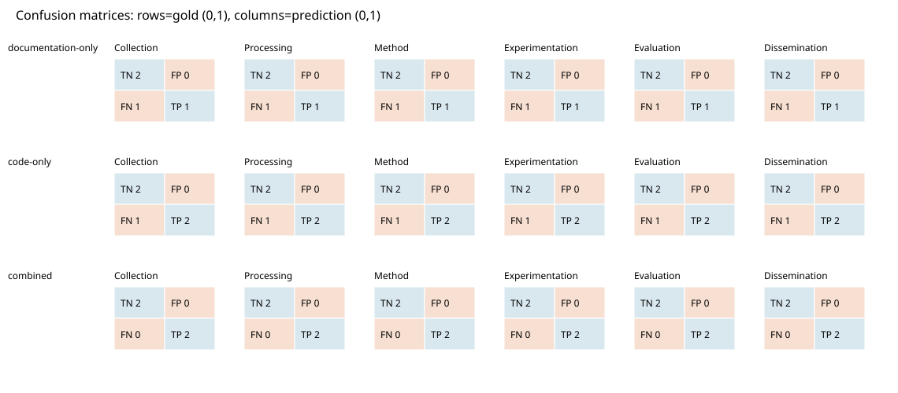

# Research Lifecycle Mapper evaluation

Benchmark: synthetic-v1 (synthetic); role: synthetic.

Candidate rules are unadjudicated. Synthetic metrics test the software and are not research performance estimates.

Incomplete scans are excluded from metrics per mode. Undefined ratios are zero. Numbers are rounded to eight decimal places.

| Mode | Evaluated | Micro F1 | Macro F1 | Exact match | Hamming loss | Coverage | Failure rate |
| --- | ---: | ---: | ---: | ---: | ---: | ---: | ---: |
| documentation-only | 4 | 0.66666667 | 0.66666667 | 0.75000000 | 0.25000000 | 0.80000000 | 0.20000000 |
| code-only | 5 | 0.80000000 | 0.80000000 | 0.80000000 | 0.20000000 | 1.00000000 | 0.00000000 |
| combined | 4 | 1.00000000 | 1.00000000 | 1.00000000 | 0.00000000 | 0.80000000 | 0.20000000 |

See errors.csv for FP/FN and failures, evidence.jsonl for matched evidence, and excluded_evidence.jsonl for vetoed candidates.

